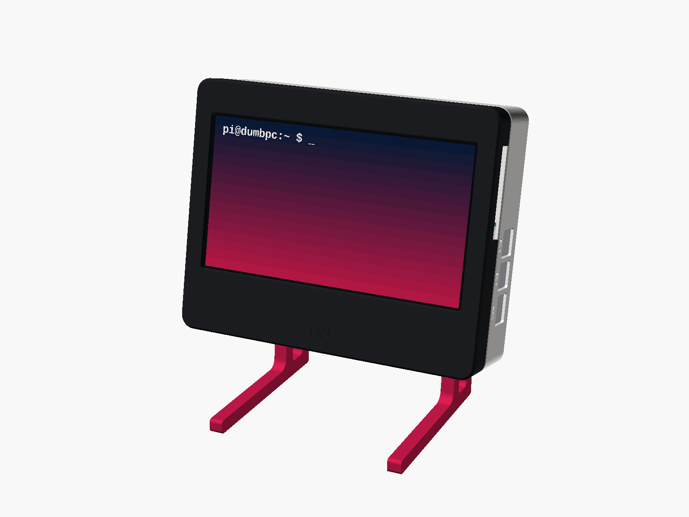
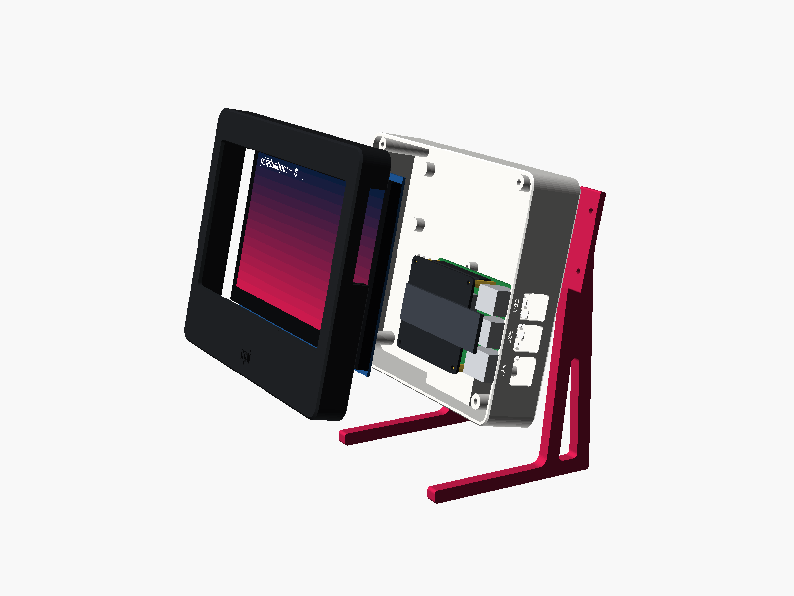
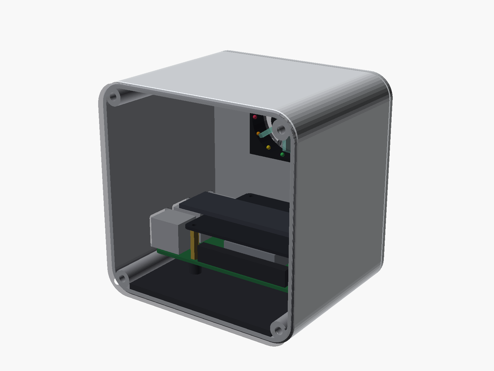
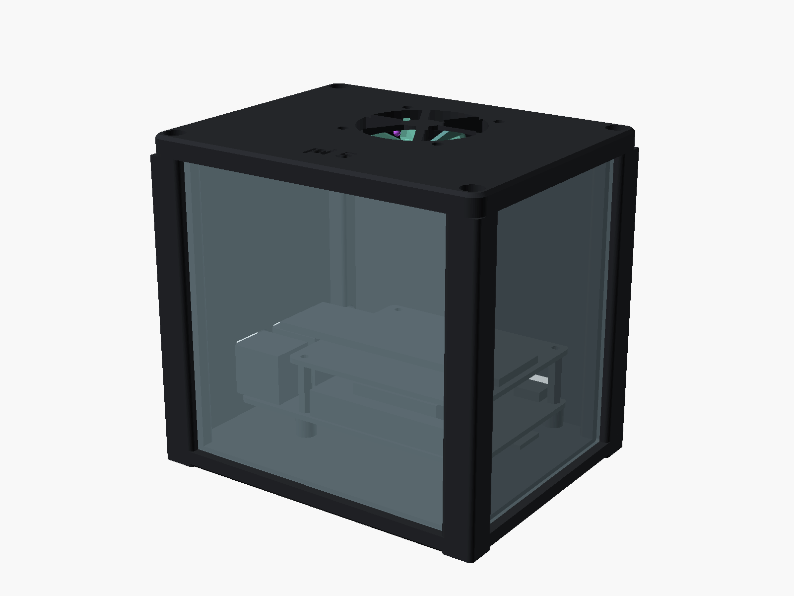
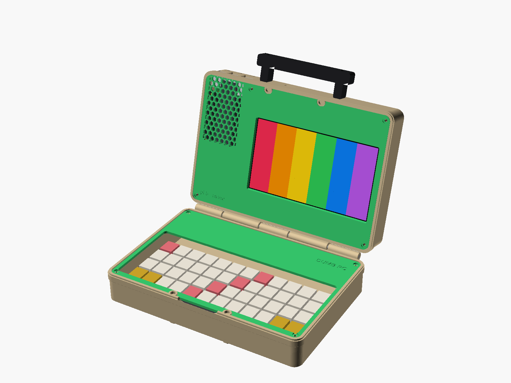
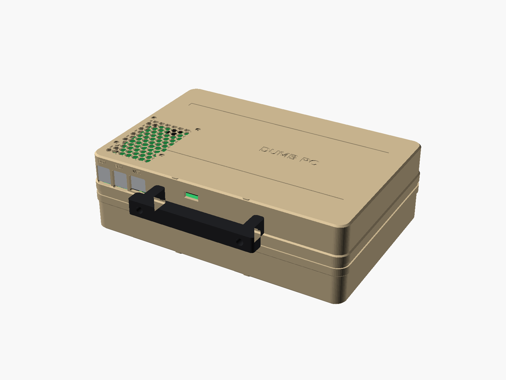

# Raspberry Pi 5 "dumb PC" cases

Four 3D-printable, fully parametric OpenSCAD cases for a **Raspberry Pi 5 + Geekworm X1001 NVMe HAT**.
Every part exports in its print orientation and needs **no supports**.

| Case | File | What it is |
|---|---|---|
| All-in-one, 5" and 7" | `aio.scad` | Screen in front, Pi + NVMe behind it, standing on two fins. Bring your own USB keyboard. |
| Cube | `cube.scad` | Rounded tube with a see-through front, 40 mm fan in the back, Pi on a slide-out sled. |
| Showcase | `showcase.scad` | Printed frame with clear front and side panels, 40 mm fan in the lid. |
| Cyberdeck | `deck.scad` | Rugged clamshell: 7" screen and Pi in the lid, a tray for your keyboard in the base. |

| | |
|---|---|
|  |  |
|  |  |
|  |  |

## Why a Pi 5, not a Pi 4

The parts order (amazon.de) is built around a Pi 5:

| ASIN | Product | Fits a Pi 4? |
|---|---|---|
| B0CPLF6JYX | Geekworm X1001 PCIe to M.2 NVMe HAT | **No.** It needs the Pi 5 PCIe FFC connector; the listing says "only for Raspberry Pi 5". |
| B08Z3GQGKX | Acer FA100 256 GB NVMe SSD, M.2 2280 | Goes in the X1001 |
| B076J8ZWFF | ELECROW 7" 1024x600 HDMI capacitive touchscreen | Yes (HDMI + USB touch) |
| B0CLXZBR5P | Raspberry Pi Active Cooler (SC1148) | **No.** It is Pi 5 only. |

There was no 5" screen in the order. The 5" AIO uses the ELECROW RC050 (121.11 x 95.24 mm board) as a stand-in until the real screen is known.

## Dimensions and sources

* **Pi 5:** official mechanical drawing RP-008347. Board 85 x 56, M2.5 holes on 58 x 49 at 3.5 mm from the edges. USB-C / micro-HDMI 0 / micro-HDMI 1 at 11.2 / 25.8 / 39.2 mm. RJ45 / USB / USB at 10.2 / 29.1 / 47 mm, sticking out 3 mm. All of it lives in `pi5.scad`.
* **ELECROW 7":** board 164.7 x 107.1 mm (ELECROW wiki, model RPD10246D). Standard 7" panel: 164.9 x 100 mm, active area 154.21 x 85.92 mm. HDMI and micro-USB are on the right edge (wiki photos).
* **ELECROW RC050 5":** 121.11 x 95.24 mm (ELECROW wiki). Standard 5" active area 108 x 64.8 mm.

### Measure these before the first print

The values below are parameters, set to sensible defaults but not confirmed:

* `hat_standoff = 16` and `hat_stack = 6`: the X1001 standoff height and HAT + SSD thickness. The Geekworm wiki blocks automated access.
* `hs_top = 12` / `hs_bottom = 6`: heatsink room above and below the Pi. Set these from the Malina V4 kit once you have its dimensions. The Active Cooler has to fit under the HAT, and an `assert` checks that.
* `glass_t`, `pcb_back` and the connector notch in `aio.scad` (`S7` / `S5`): screen module thickness and connector position. Check them with calipers. The 5" values are a stand-in.

## Bill of materials

Common: M3 heat-set inserts (5.7 mm, Ø4.0 hole), M2.5 x 14 screws (Pi stack, driven from the case side into the X1001 brass standoffs), and 10 mm bumpon feet.

* **AIO:** 4x M3 x 10 (bezel), 4x M3 x 8 (fins). The screen sits on 0.5–1 mm VHB foam tape on the bezel ledge. To link the screen, use a short micro-HDMI → HDMI cable from HDMI0 in the bottom port bay to the screen's HDMI in the right-side notch, plus a short USB-A → micro-USB for touch.
* **Cube:** 8x M3 x 8, 1x 40 mm 5 V fan + 4x M3 x 16. The front is clear PETG or 3 mm acrylic (`stl/cube-window.svg`).
* **Showcase:** 4x M3 x 10, 1x 40 mm fan. 2 mm acrylic panels (`stl/showcase-panel-*.svg`), or print them in clear PETG.
* **Cyberdeck:** 8x M3 x 8 (plate + bezel), 2x M3 x 16 (handle), 4x 6 x 3 mm magnets, a 4 mm x 226 mm steel rod or the printed `hinge_pin`, a panel-mount USB-C extension (28 mm screw ears), and a 10 cm FPC HDMI kit (micro-HDMI 90° + HDMI 90°). Mount the screen upside down so its connectors face the Pi, and set the display rotation to 180° in the OS. Keyboards up to 230 x 96 mm and 33 mm tall fit.

## Printing

PETG or ASA for anything near the Pi (PLA softens around 55 °C). Use 0.2 mm layers, 3 walls and 15–20 % infill. Every part fits a 256 x 256 mm bed. The deck halves are the largest at 249 x 178 mm including the hinge knuckles.
The deck lid and the AIO port bay bridge 14–44 mm, so turn on bridging and part cooling.

## Rebuild

```bash
./build.sh            # every case
./build.sh aio deck   # just these
```

Every dimension is a Customizer parameter at the top of its `.scad` file. Open a file in OpenSCAD and use *Window → Customizer*.
